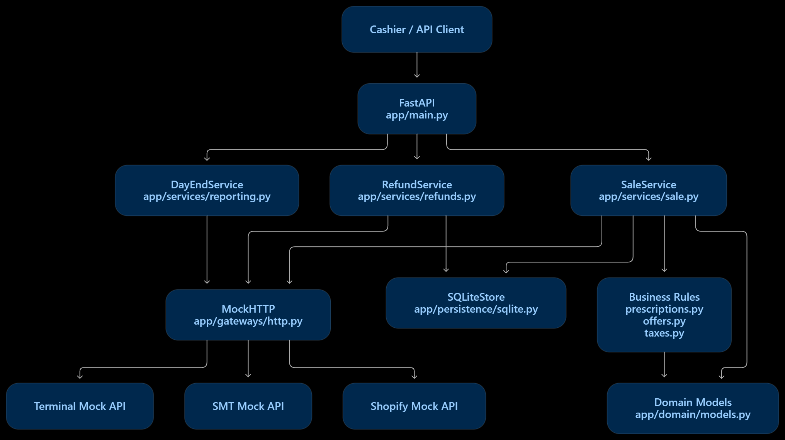
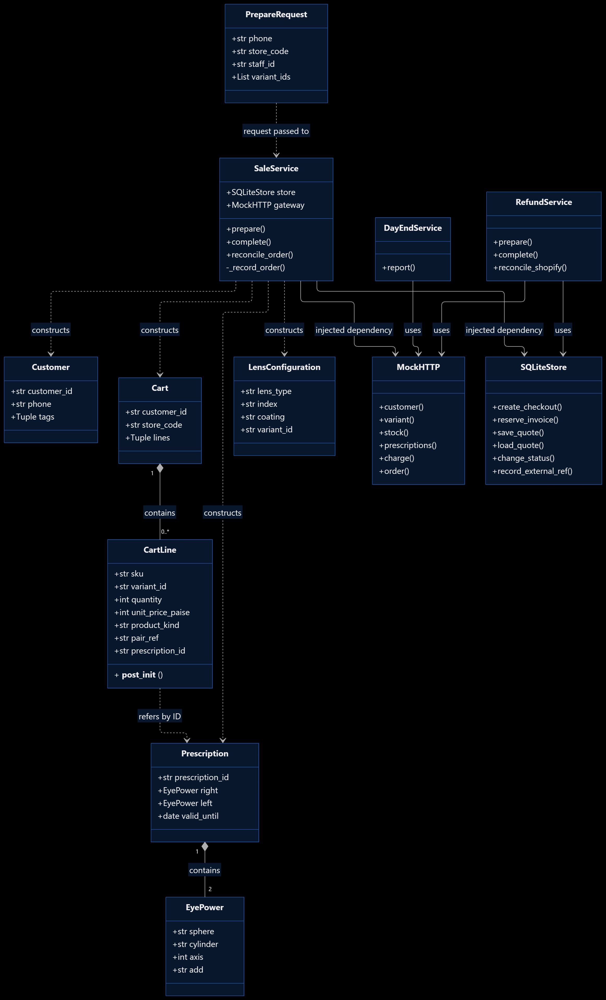

# Eluno Store Studio

A store billing demo built for the Eluno POS exercise. It replaces the till experience while keeping **Shopify as the system of record** for orders, transactions, stock and refunds.

The project includes a browser frontend and Swagger UI using the same FastAPI backend. Customers, products and inventory come from the supplied Shopify Admin mock; prescriptions and staff come from the store-tool mock; charges and refunds use the supplied payment-terminal mock.

**This submission uses local mocks and synthetic data. It does not connect to a live Shopify shop or move real money.**

**Recorded QC:** 414 tests passed in the full suite on 26 October 2026, followed by focused browser/API checks. See the [QC report and manual review checklist](docs/WEBSITE_QC_2026-10-26.md).

[Quick start](#quick-start) · [Demo walkthrough](#demo-walkthrough) · [HLD](#high-level-design-hld) · [LLD](#low-level-design-lld) · [API workflow](#api-workflow) · [Database](#database-and-data-ownership) · [Tests](#testing-and-qc) · [Limitations](#scope-and-production-boundaries)

## Quick start

### Requirements

- **Python 3.10+** for the application; **Python 3.13 is the verified runtime**. The supplied mock alone supports Python 3.8+.
- Internet access for installing dependencies on the first run.
- No frontend build, Node installation or separate database server is needed to run the app.

Clone the repository and run from its root:

```powershell
git clone https://github.com/VairagPatel/Shopify-POS.git
cd Shopify-POS
python start.py
```

On macOS/Linux, use `python3 start.py` if `python` is not available.

The launcher creates `.venv`, installs runtime dependencies, provisions missing demo accounts, and starts both the application and the durable mock wrapper. Existing accounts and runtime data are preserved.

| Service | Default URL |
| --- | --- |
| Frontend | http://127.0.0.1:8000 |
| Swagger UI | http://127.0.0.1:8000/docs |
| Health | http://127.0.0.1:8000/health |
| Internal mock | http://127.0.0.1:8787 |

If those ports are occupied:

```powershell
python start.py --port 8001 --mock-port 8788
```

Then use http://127.0.0.1:8001 and http://127.0.0.1:8001/docs. The current local review instance uses these alternate ports.

### Login and accounts

Generated usernames and passwords are saved locally in **`runtime/demo-accounts.txt`**. This file is ignored by Git. Passwords are generated during setup; there is no public default password.

| Username | Role | Store access |
| --- | --- | --- |
| `admin` | Administration and complete demo review | All stores |
| `manager` | Sales, manager discounts, refunds, remakes and drawer close | HSR |
| `cashier` | Sales and permitted cash-drawer operations | HSR |
| `optometrist` | Prescription entry and permitted store views | HSR |
| `finance` | Central reports, audit and outbox review | All stores |

Permissions and store restrictions are enforced by the backend. Hiding a UI control is not the permission check.

To reset an existing admin password, run the interactive provisioning tool from the repository root:

```powershell
.\.venv\Scripts\python.exe scripts/manage_users.py admin --role admin --store "*" --staff S108 --name "Demo owner"
```

It prompts for a password of at least 12 characters and revokes the account's existing sessions. When using a custom database location, supply the same `ELUNO_DB_PATH` used by the runner.

<details>
<summary>Manual setup without the launcher</summary>

```powershell
python -m venv .venv
.\.venv\Scripts\python.exe -m pip install -r requirements.txt
.\.venv\Scripts\python.exe scripts/setup_demo.py
.\.venv\Scripts\python.exe run_demo.py --port 8001 --mock-port 8788
```

On macOS/Linux, replace `.venv\Scripts\python.exe` with `.venv/bin/python`.

</details>

Stop the runner with **Ctrl+C**. Restart it after backend changes and refresh the browser. A newer frontend paired with an old backend can otherwise produce missing-endpoint errors such as `/api/draft/metadata` returning 404.

## Exercise deliverables

| Part | Repository entry point |
| --- | --- |
| **Part A: stakeholder reply** | [STAKEHOLDER_REPLY.md](STAKEHOLDER_REPLY.md): questions, conflicts, scope, deferrals and dependencies |
| **Part B: implementation** | Runnable till flow, authenticated frontend, Swagger, adapters, persistence and automated tests |
| **Part C: walkthrough** | Submit a Loom recording of up to eight minutes with the repository link. The Loom URL must be supplied in the submission email. |

The frontend is an additional demonstration aid; the core flow can also be presented through Swagger. AI assistance was used for implementation, test scenarios, refactoring and documentation.

## Demo walkthrough

1. Sign in as `admin` or `manager`. Open **New sale** or choose **Start guided sale / Load sample customer**.
2. The guided example loads **Divya Iyer**, an available frame and a compatible progressive lens. For manual lookup, use `9000000004` or `+919000000004`; both identify the same customer.
3. Show the customer's prescription and flags. Select products using the separate **Frames**, **Lenses** and **Sunglasses** tabs.
4. In **Lenses**, choose a destination, then **lens type → index → coating → Add lens to cart**. Attach one lens pair to a selected frame, or choose a lens-only purchase for the customer's own frame. Frame-only purchases are supported explicitly.
5. Check the separately priced cart lines. Remove one lens, one standalone frame or an entire pair. Repeated frames are tracked as individual selections.
6. Coupons start blank. Choose an eligible code and click **Apply coupon & review bill**. A manager discount requires both the percentage and reason and replaces the coupon.
7. Select **Review offers & GST**, inspect the exact amount, then confirm payment. Cash requires an open drawer. Confirming payment creates the source order and issues the local invoice.
8. In **Bills & returns**, inspect the invoice, payment reference, source order and local saved records. Print the invoice if needed.
9. As manager/admin, prepare and confirm a **full refund**. Inspect the source refund ID, synchronization timestamp, credit note and frame restock at the billing store.
10. Open **Daily reports**, choose the date and download a CSV. Use another account to demonstrate role restrictions.

The sample data and offer windows belong to the 2026 exercise. The app uses the current India business date. Expired prescriptions need a clinician-confirmed replacement; expired offers stop applying. Some seeded customers have incomplete clinical fields. For example, Karthik's supplied prescription has missing axes, so a clinician must confirm a complete prescription before billing lenses for him.

## Implemented workflows

| Area | Behavior |
| --- | --- |
| Customer lookup | Shopify customer lookup by normalized Indian phone; phone is sent in a JSON body |
| Clinical | Latest valid prescription per wearer; sphere/cylinder limits; ADD for progressive/bifocal lenses; axis **0°, 5°, …, 180°**; missing axis rejected |
| Products | Frame-only, lens-only, complete prescription pairs, ready-to-wear sunglasses and compatible prescription sunglasses |
| Family billing | Up to ten wearer entries, each retaining its own prescription and up to 30 selected units |
| Offers | JSON-configured dates, conditions, caps and rejection reasons; only the explicitly selected coupon applies |
| Manager discount | Exact entered percentage up to 10%, with authorized identity and reason |
| GST | Inclusive MRP, effective-date HSN rates, per-line taxable value, CGST/SGST and exact paise reconciliation |
| Payments and orders | Terminal result saved before source-order creation; complete submitted order snapshot retained |
| Invoices | Per-store sequence independent of Shopify order number; durable issued invoices, line view and printable HTML |
| Full refunds | Original-line tax reversal, source refund, original-store frame restock and no lens restock |
| Remakes | Linked lens-only order, original frame untouched, cost owner and lab cost recorded |
| Cash drawer | Opening float, cash sales/refunds, reasoned paid-ins/paid-outs, counted close and variance |
| Reports | Shopify-derived store/day and combined totals, channel attribution, payment-method split and CSV download |
| Tracking | Draft versions, prescription authorship, payment/order state, invoice records, refund events and audit history |
| Outbox | Durable report previews, scheduled 10am IST digest and cash-variance alerts; SMTP configuration enables delivery |

## End-to-end data flow

1. **Read source data:** the backend reads the customer, product variants, store locations and stock from Shopify; it reads staff and prescriptions from the store tool and merges locally entered prescriptions.
2. **Validate the cart:** each lens is associated with its wearer. Type, index, coating and prescription limits are checked. A frame has at most one attached lens pair. Stock demand is checked across the bill.
3. **Calculate the bill:** local `offers.json` and `tax_rates.json` supply offer and effective-date tax data. Money calculations use integer paise.
4. **Save the quote:** SQLite stores the approved lines, totals and references and reserves a per-store invoice number. Preparing a quote does not charge the terminal or create an order.
5. **Confirm payment:** the terminal is charged and its result is persisted. The final source-order request is saved before it is sent.
6. **Create the Shopify order:** the adapter sends line items, tax lines, discounts, successful sale transaction, store/invoice references and an Rx ID plus clinical snapshot on each lens line.
7. **Issue the invoice:** after the source order is recorded, SQLite stores the issued invoice. The original invoice remains available after a refund.
8. **Refund and reconcile:** the original source order supplies refundable lines and tax. The terminal reversal and Shopify refund are recorded in stages. Frames return to the billing location; made-to-order lenses are not restocked.
9. **Report from Shopify:** day-end and leadership reports read source orders/refunds. SQLite retains operational evidence and recovery state.

## High-level design (HLD)

The HLD shows the main application services, storage, business rules and external mock systems.

[](docs/assets/hld-architecture.png)

**Reading the supplied diagram:** `MockHTTP` is the provider transport. In the current implementation, services reach the provider through **`BillingAdapter` and gateway protocols**; **`SQLiteStore` implements repository protocols**. Authentication and the frontend-facing routes are installed through `app/web.py`.

| Component | Responsibility |
| --- | --- |
| Frontend / Swagger | Two clients of the same API and saved workflows |
| FastAPI + security boundary | Authentication, CSRF, role/store scope, input validation and orchestration |
| SaleService / RefundService / DayEndService | Business workflow and recovery rules |
| Gateway protocols + BillingAdapter | Provider-neutral records and explicit external-system boundaries |
| MockHTTP + Shopify mapping | HTTP transport and Shopify-specific request/response conversion |
| SQLiteStore | Drafts, quotes, states, invoice series, invoices and refund evidence |
| Supplied mocks + durable wrapper | Shopify Admin, store-tool and terminal behavior; source-state persistence |

Shopify remains the source of truth for commercial orders, inventory and refunds. The domain's clinical, tax and discount calculations can remain when a provider adapter is replaced. A complete provider migration still needs new integration contracts, identifier mapping and reconciliation validation.

Read the [detailed HLD](docs/HLD.md), [problem-led design](docs/PROBLEM_HLD.md) and [system/sequence diagrams](docs/SYSTEM_DIAGRAMS.md).

## Low-level design (LLD)

The LLD class diagram shows the request, workflow services, cart models, prescriptions and persistence relationships. Click the image to view it at full resolution.

[](docs/assets/lld-class-diagram.png)

The diagram shows the core classes and fields. The current `PrepareRequest` also supports wearer selections, independent frame/lens arrays, coupon selection and manager-discount inputs. Service constructor annotations use **`SaleGateway` / `RefundGateway` / `ReportingGateway`** and repository protocols; the concrete adapter/store names in the supplied drawing identify their runtime implementations.

- **Domain:** `Customer`, `Cart`, `CartLine`, `LensConfiguration`, `Prescription` and `EyePower` represent internal concepts.
- **Rules:** prescription, offer and tax services perform deterministic calculations without network access.
- **Orchestration:** sale/refund services coordinate validation, durable state and external effects.
- **Adapters:** provider-specific payloads and decimal money strings are assembled at the boundary.
- **Persistence:** compare-and-set transitions and unique references protect state and invoice allocation.

See the [detailed LLD](docs/LLD.md) and [API/schema guide](app/static/api-schema-guide.html).

## API workflow

Swagger is available at `/docs`. Sign in there using **`POST /auth/login`**; its request interceptor supplies the session CSRF token for authenticated write calls. The frontend and Swagger operate on the same database and source records.

| Step | API | Result |
| --- | --- | --- |
| Sign in | `POST /auth/login` | Session cookie and CSRF token |
| Discover source IDs | `GET /api/bootstrap`, `GET /api/inventory` | Stores, products, staff, offers and stock |
| Find customer/Rx | `POST /api/customers` | Customer and available prescriptions; phone stays in the body |
| Clinical entry | `POST /api/prescriptions` | Clinician-authored prescription and audit identity |
| Save/resume cart | `PUT /api/draft`, `GET /api/draft` | Latest resumable cart |
| Inspect draft history | `GET /api/draft/metadata`, `GET /api/drafts/history` | Draft ID, authorship, timestamps and versions |
| Review bill | `POST /sales/prepare` | Validated quote and reserved store invoice number |
| Confirm payment/order | `POST /sales/{checkout_id}/complete` | Payment then source order then issued invoice |
| Inspect evidence | `GET /api/checkouts/{identifier}/detail` | Quote, source order, issued invoice, refund attempts/events |
| Full refund | `POST /refunds/prepare`, `POST /refunds/{refund_id}/complete` | Original-line reversal and synchronized source refund |
| Day-end | `GET /reports/day-end?store_code=HSR&date=YYYY-MM-DD` | Required source-derived store/date report |
| Website reports/export | `GET /api/reports`, `GET /api/reports/export` | Daily/combined figures and downloadable CSV |

An example manager/admin quote request:

```json
{
  "phone": "+919000000004",
  "store_code": "HSR",
  "staff_id": "S108",
  "variant_ids": [],
  "members": [
    {
      "phone": "+919000000004",
      "variant_ids": [91000003, 91000083],
      "lens_only_variant_ids": [],
      "frame_only_variant_ids": []
    }
  ],
  "payment_method": "upi",
  "channel": "walk_in",
  "selected_offer_id": "FESTIVE10"
}
```

This example needs the offer's active date window. Omit `selected_offer_id` for no coupon discount. A manager override uses `override_bps` (`500` = 5%) and `reason_code`; the API checks the authenticated role and staff identity. Cashier requests must use their own staff ID, such as HSR `S105`.

See [API walkthrough](docs/API_WALKTHROUGH.md) and [OpenAPI export](docs/openapi-contract.json) for the complete current schemas and request examples.

## Pricing and recovery decisions

- **Money:** integer paise inside the application; decimal strings at the Shopify/payment boundary.
- **Offers/tax:** data is in `exercise-pack/starter-kit/data/offers.json` and `tax_rates.json`. Updating a configured rule or rate does not require editing pricing code.
- **Coupon policy:** no automatic coupons or implicit stacking. This is the requested cashier workflow; stakeholder-wide offer-combination policy remains a business decision.
- **Prescriptions:** each wearer has independent validation; ADD is required for progressive/bifocal lenses. Axis zero is a valid value, distinct from a missing axis.
- **Invoice numbering:** store-local numbers are reserved and retained as issued, reserved or cancelled. They are not Shopify's global order numbers.
- **Network failures:** safe reads handle transient `429`/`503` responses. Ambiguous financial writes enter persisted uncertainty states and require inspection/reconciliation.
- **Idempotent completion:** a repeated successful completion returns the existing result. The app does not blindly repeat an uncertain charge, order or refund write.
- **Execution model:** one application worker with serialized authenticated mutations. There is no distributed atomic transaction across the terminal, Shopify and SQLite.

## Database and data ownership

The active local database is **`runtime/eluno.sqlite3`**, unless `ELUNO_DB_PATH` overrides it. The source mock's durable snapshot is **`runtime/mock-state.json`**. Both are ignored by Git.

| SQLite object | Data to inspect |
| --- | --- |
| `drafts` | Latest resumable cart per account |
| `cart_snapshots` / `cart_tracking` | Every saved cart version, draft ID, actor/staff ID, timestamps and checkout/source links |
| `prescriptions` | Rx payload, normalized phone, author, staff ID, store and creation time |
| `checkouts` / `checkout_quotes` | Durable workflow state, references, approved lines/tax/offers and checkout duration |
| `order_submissions` | Exact final order request saved before the external write |
| `invoice_allocations` | Complete per-store reserved/issued/cancelled numbering register |
| `invoices` / `invoice_lines` | Issued invoices and browsable line/HSN/discount/GST/Rx fields |
| `refund_attempts` / `refund_events` | Refund payloads, transitions, terminal/source IDs and synchronization time |
| `tills`, `expenses`, `paid_ins` | Cash sessions, paid-outs and paid-ins |
| `audit`, `outbox` | Action history and report delivery state |

Open the existing SQLite file in DB Browser for SQLite, a SQLite extension in VS Code, or the `sqlite3` CLI. Refresh the viewer after using the app. Completed POS orders create issued invoices; unpaid drafts remain separate, and seeded/external Shopify orders are not assigned invented POS invoice numbers.

```sql
SELECT invoice_no, checkout_id, store_code, shopify_order_id,
       total_paise, payment_method, issued_at
FROM invoices ORDER BY issued_at DESC;

SELECT * FROM invoice_lines ORDER BY invoice_no, line_number;

SELECT refund_id, checkout_id, status, shopify_refund_id, synced_at
FROM refund_attempts ORDER BY updated_at DESC;

SELECT draft_id, created_by, created_by_staff_id, saved_at,
       saved_status, checkout_status, invoice_no, payload
FROM cart_tracking ORDER BY saved_at DESC;
```

Keep the application database and mock snapshot together when backing up or moving the demo. Restoring only one side can break cross-system references. The supplied original mock remains unchanged; the runner uses an additive persistence/privacy wrapper. Runtime files contain customer/demo data and credentials and should stay outside the repository.

## Day-end reports and downloads

The required day-end report is computed from **Shopify orders**, with bill count, gross, taxable amount, tax, discounts, refunds and successful sale-payment totals by method.

The website provides two exports with explicit accounting bases:

- **Download day-end CSV:** orders from the selected store/date, including refunds on those orders regardless of refund date; matches the original exercise report.
- **Download daily summary CSV:** the website collections view; refunds use the actual refund event date, including returns of older bills.

Store roles can access their own store. Admin/finance can review all seven stores and download combined totals. Failed refund transactions are excluded from refund totals. The source mock has a bounded order result size; reporting rejects capped/incomplete results instead of presenting them as complete.

## Testing and QC

The recorded full-suite result is **414 passed**. Follow-up checks also exercised old-quote recovery, repeated-frame removal, combined lens conditions, prescription sunglasses, zero axes, invoice/refund storage and CSV downloads. These counts describe the recorded local verification, not a claim about production payment providers or performance.

Install the development dependencies and run the complete suite with Google Chrome installed:

```powershell
.\.venv\Scripts\python.exe -m pip install -r requirements-dev.txt
.\.venv\Scripts\python.exe -m pytest tests -q
```

For backend checks without Playwright/browser dependencies:

```powershell
.\.venv\Scripts\python.exe -m pytest tests -q --ignore=tests/test_browser_roles.py --ignore=tests/test_browser_coupons.py --ignore=tests/test_browser_sales_components.py
```

Additional checks:

```powershell
.\.venv\Scripts\python.exe exercise-pack/starter-kit/validate_seed.py
node --check app/static/app.js
```

Node is optional for that syntax check. CI installs Chromium and runs the acceptance suite, fixture validation and syntax check; see [the workflow](.github/workflows/tests.yml).

Tests cover financial math, source integration, per-store numbering, repeated/uncertain writes, role and store access, phone privacy, independent products, clinical constraints, cash, reports and real browser journeys. Browser/integration fixtures use isolated databases and mocks. The standalone `scripts/browser_smoke.py` instead targets the running demo and creates a synthetic sale/refund.

Read the [QC report and manual checklist](docs/WEBSITE_QC_2026-10-26.md) before your own review.

## Configuration and deployment

| Setting | Purpose |
| --- | --- |
| `ELUNO_RUNTIME` | Runtime directory for the runner's persistent files |
| `ELUNO_DB_PATH` | Override the active SQLite file |
| `ELUNO_MOCK_URL` | Internal mock address; set by the runner |
| `ELUNO_PRIVATE_LOOKUP` | Runner sets `1` for body-based private lookup extensions; explicit legacy mode `0` uses the original upstream URL contracts |
| `ELUNO_ADMIN_PASSWORD` | First-boot container admin provisioning when no users exist |
| `ELUNO_SECURE_COOKIES` | Use `1` behind HTTPS; Docker defaults to secure cookies |
| SMTP and recipient settings | Configure actual email delivery; see the deployment guide |

A Dockerfile is included. Deployment requires a persistent `/data` volume, one worker/replica, writable storage and HTTPS. Only expose the UI/API port; keep the mock internal. Without SMTP, generated reports remain reviewable in **Report outbox** as queued messages.

See [deployment and SMTP instructions](docs/DEPLOYMENT.md). The repository is published on GitHub; no public hosted demo URL is claimed here.

## Scope and production boundaries

The demo covers the core Must workflows and selected operational additions. The following are explicitly deferred or require external validation:

- Live Shopify/payment onboarding and production terminal-outcome recovery.
- Seven-store rollout, device/network validation and proving billing under ten seconds in production.
- Finance approval of legal invoice/credit-note documents and business approval of broader offer stacking.
- Full offline payment processing, horizontal scaling and production SSO.
- New-customer registration, partial refunds and the optional AI Stretch features.
- Beverage-question removal and footfall-camera repair in systems not supplied with the exercise.
- Actual email delivery until SMTP and recipients are configured.

## Further documentation

| Document | Use it for |
| --- | --- |
| [Stakeholder reply](STAKEHOLDER_REPLY.md) | Part A: scope, contradictions, questions and dependencies |
| [Detailed HLD](docs/HLD.md) / [problem-led HLD](docs/PROBLEM_HLD.md) | Requirements, system responsibilities and design decisions |
| [Detailed LLD](docs/LLD.md) / [sequence diagrams](docs/SYSTEM_DIAGRAMS.md) | Classes, interfaces, schemas and state transitions |
| [Current website QC](docs/WEBSITE_QC_2026-10-26.md) | Verified workflows, coupon amounts, storage and manual review |
| [API walkthrough](docs/API_WALKTHROUGH.md) / [OpenAPI](docs/openapi-contract.json) | Swagger demonstration and source/API contracts |
| [Founder briefing](app/static/founder-brief.html) | Simple-English feature explanation; served at `/static/founder-brief.html` |
| [Visual flow guide](app/static/flow-guide.html) | Single-reading sale/refund explanation; served at `/static/flow-guide.html` |
| [API/schema guide](app/static/api-schema-guide.html) | Internal/external schemas and identity tracking; served at `/static/api-schema-guide.html` |
| [Deployment guide](docs/DEPLOYMENT.md) | Persistent hosting, accounts, HTTPS, SMTP and backup |

Earlier planning/audit documents remain in the repository as history. This README and the dated website QC report describe the current demonstrated workflow.
