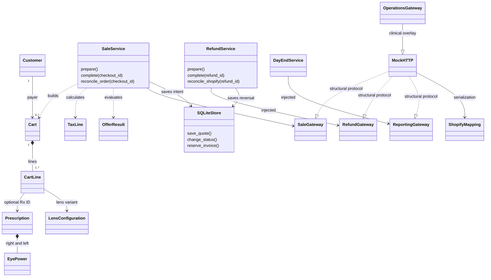
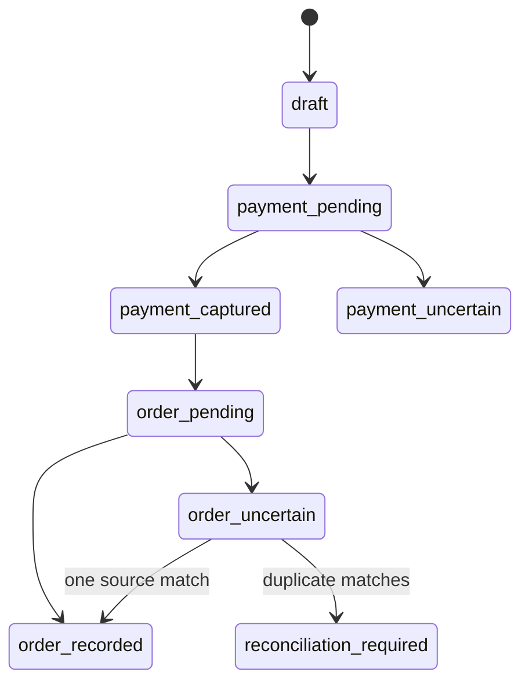
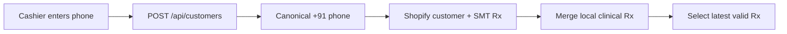
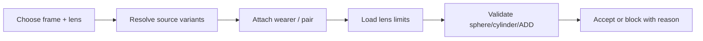
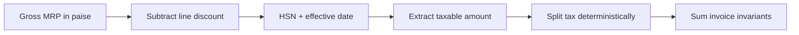
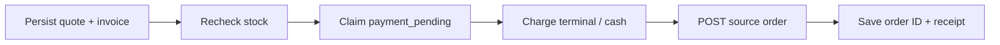
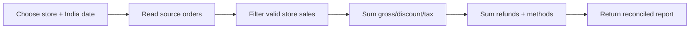
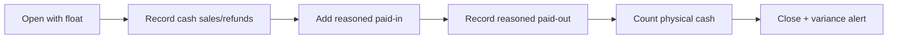

# Submission diagrams — current implementation

These diagrams describe the implemented demo. Runtime integration dictionaries still couple some application orchestration to Shopify; pure domain rules are provider-independent. Not all database relationships are enforced foreign keys.

## Class relationships



## Payment/order sequence

```mermaid
sequenceDiagram
actor Cashier
participant API
participant SaleService
participant DB as SQLiteStore
participant Terminal
participant Shopify
Cashier->>API: POST /sales/prepare
API->>SaleService: authenticated preparation
SaleService->>Shopify: read customer, variant, store, stock
Note over SaleService: Rx from store tool; validate offers and tax
SaleService->>DB: persist quote and invoice allocation
API-->>Cashier: checkout_id and totals
Cashier->>API: POST /sales/{id}/complete
SaleService->>Shopify: recheck inventory
SaleService->>DB: claim payment_pending
SaleService->>Terminal: one charge
alt definite result
Terminal-->>SaleService: charge_id
SaleService->>DB: persist captured state
SaleService->>Shopify: create paid order
Shopify-->>SaleService: order_id
SaleService->>DB: record source ID and completion
API-->>Cashier: invoice
else timeout
SaleService->>DB: uncertain state
API-->>Cashier: inspect/reconcile, do not recharge
end
```

## Recovery states



## M1: Customer and latest valid prescription



## M2: Frame + lens selection and clinical validation



## M3: Offers, dates, conditions and stackability


## M4: Inclusive GST and exact line arithmetic



## M5: Payment, source order and store invoice



## M6: Full refund, original tax and correct stock


## M7: Store/date day-end and central totals



## S1: Cash till, paid-ins, paid-outs and close


